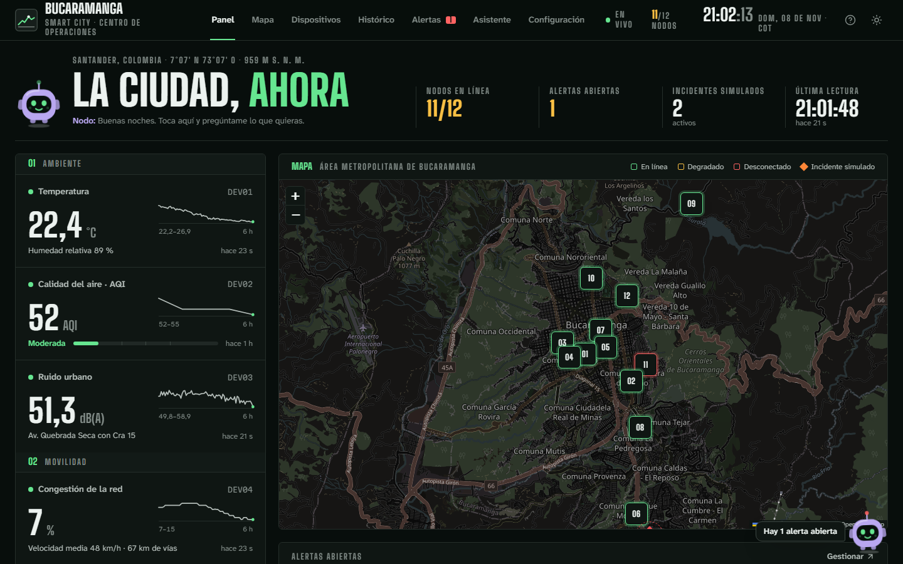
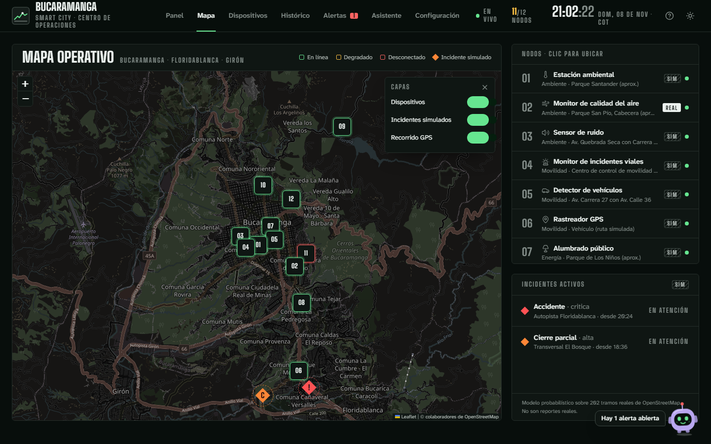
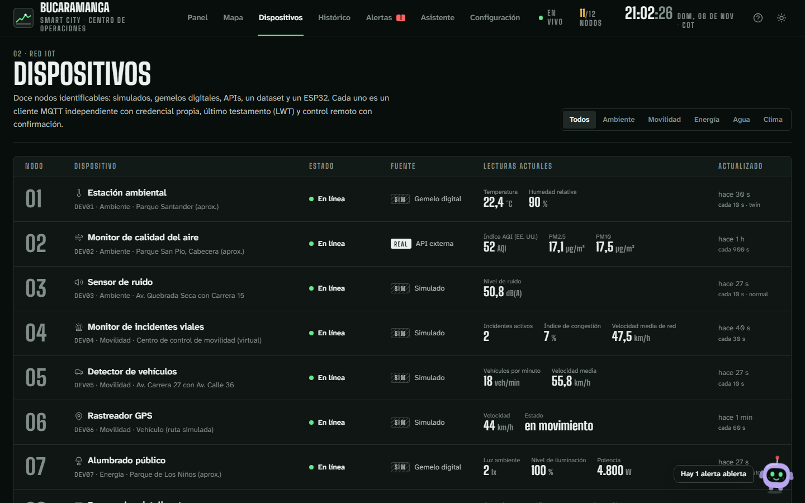
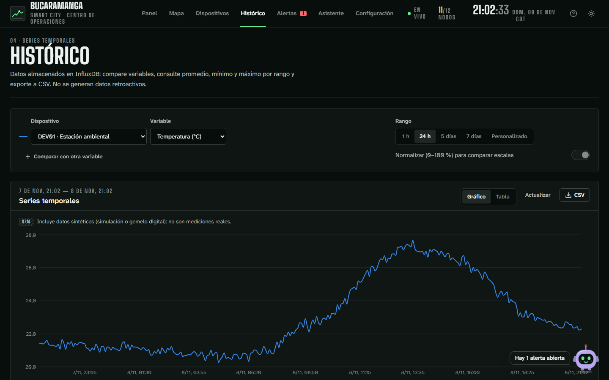
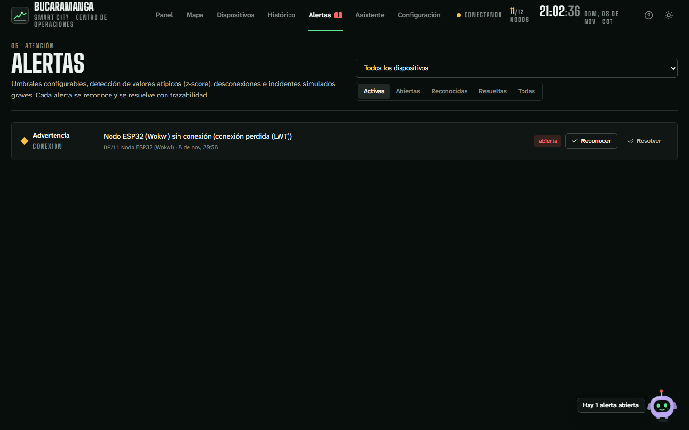
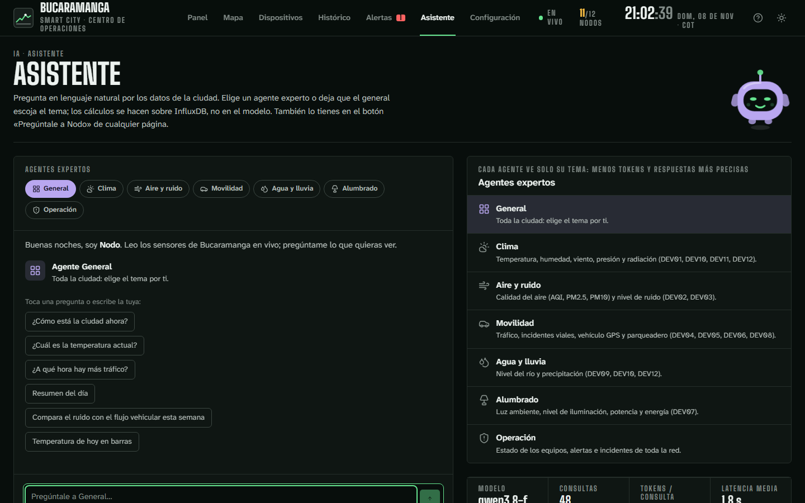
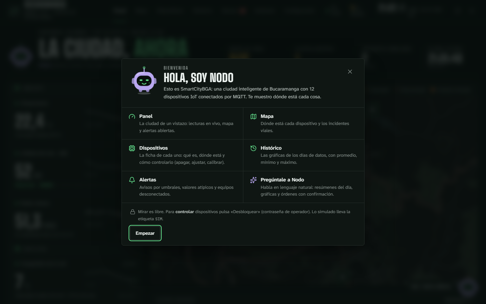
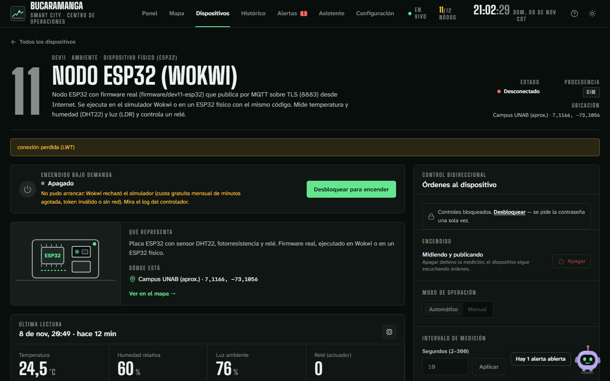
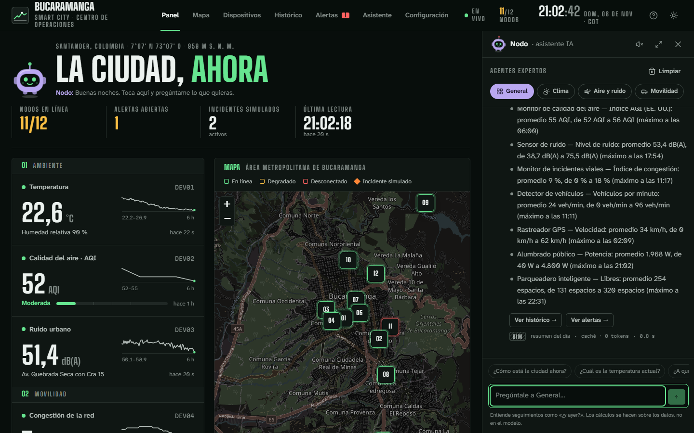

# Smart City Bucaramanga (SmartCityBGA)

Plataforma IoT académica que simula y monitorea una ciudad inteligente en Bucaramanga, Colombia:
12 dispositivos identificables (simulados, gemelos digitales, APIs, un dataset y un ESP32 real), comunicación MQTT bidireccional, persistencia en series
temporales, alertas, control remoto con confirmación y una aplicación web en tiempo real.

> Plan técnico y estado del proyecto: [`docs/PLAN.md`](docs/PLAN.md)
> Bitácora: [`docs/BITACORA.md`](docs/BITACORA.md) · Asistente IA: [`docs/IA.md`](docs/IA.md)

## Cómo se ve

Capturas del sitio en vivo (tema oscuro «Sala de control»: verde señal para lo operativo y lavanda solo para la voz de la IA). Nodo, el asistente, es el personaje de la app: saluda, habla (voz opcional), resume el día, dibuja gráficas en la forma que pidas y propone órdenes que tú confirmas. La primera visita abre una guía de dónde está cada cosa (botón «¿Cómo se usa?»). Para regenerar las capturas ver [`docs/capturas/README.md`](docs/capturas/README.md).

| | |
|---|---|
| **Panel** — estado de la ciudad de un vistazo<br> | **Mapa** — dispositivos e incidentes<br> |
| **Dispositivos** — control con confirmación<br> | **Histórico** — series y comparación<br> |
| **Alertas**<br> | **Nodo, el asistente IA** — agentes expertos por tema<br> |

**Primera visita** — Nodo explica dónde está cada cosa (reabrible con «¿Cómo se usa?»):



**Ficha de dispositivo** — ilustración, qué representa, dónde está y, en DEV11, encendido bajo demanda:



El asistente también vive en un panel lateral acoplado a cualquier página:



## Arquitectura

```
 Fuentes                       Broker                 Servicios (Docker Compose)
┌───────────────────────┐ MQTT ┌───────────┐  ┌──────────────────────────────────────────┐
│ devices (Node/TS)     │◄────►│ Mosquitto │◄►│ Node-RED → validación → InfluxDB (raw)    │
│ 10 clientes MQTT, LWT │ QoS1 │ auth + ACL│  │   + reglas de automatización              │
│ Open-Meteo · IDEAM ·  │      └───────────┘  │ Backend (Fastify): REST + WebSocket,      │
│ GPS · simulación OSM  │                     │   órdenes con ack, alertas, SQLite        │
└───────────────────────┘                     │ InfluxDB 2.7 (raw 30 d, agg_5m 1 año)     │
                                              │ Grafana · Nginx (SPA React + proxy)       │
                                              └──────────────────────────────────────────┘
```

| Carpeta | Contenido |
|---|---|
| `packages/shared` | Contrato MQTT (esquemas zod), catálogo de los 10 dispositivos, validación de órdenes |
| `apps/devices` | Dispositivos virtuales, adaptadores (Open-Meteo, IDEAM, GPS), simulador de tráfico e incidentes |
| `apps/backend` | API REST, WebSocket, puente MQTT, motor de alertas, consultas a InfluxDB |
| `apps/frontend` | Aplicación web (Vite + React + TS + Tailwind + Recharts + Leaflet) |
| `infra/` | Mosquitto, Node-RED, InfluxDB, Grafana, Nginx y scripts |

## Dispositivos y procedencia de los datos

| ID | Dispositivo | Fuente | ¿Dato real? |
|---|---|---|---|
| DEV01 | Estación ambiental | Gemelo digital sobre línea base Open-Meteo | Sintético |
| DEV02 | Calidad del aire | API Open-Meteo Air Quality (modelo CAMS) | Real (modelo) |
| DEV03 | Sensor de ruido | Simulación | Sintético |
| DEV04 | Incidentes viales | Simulación probabilística sobre vías reales OSM | **Sintético** |
| DEV05 | Detector de vehículos | Simulación (modelo de tráfico compartido) | Sintético |
| DEV06 | Rastreador GPS | Ruta simulada por defecto; gpsmobile.co solo con autorización | Según la fuente |
| DEV07 | Alumbrado público | Gemelo digital (modelo solar) | Sintético |
| DEV08 | Parqueadero | Simulación | Sintético |
| DEV09 | Nivel de agua | Dataset IDEAM (estación MAJADAS) | Real |
| DEV10 | Estación meteorológica | API Open-Meteo Forecast | Real (modelo) |
| DEV11 | Nodo ESP32 (Wokwi) | **Real**: firmware ESP32 por MQTT/TLS 8883 ([`firmware/dev11-esp32`](firmware/dev11-esp32)) | Sensores de Wokwi (en placa física, reales) |
| DEV12 | Estación histórica | **Dataset** CSV ERA5 (Open-Meteo Historical), mismo día de 2025 | Real (reanálisis) |

Cada mensaje lleva `source_type` y `provenance.synthetic`; la interfaz lo muestra siempre.

## Puesta en marcha local

Requisitos: Docker Desktop, Git Bash, Node.js **22 o 24 LTS** (Node 20 llegó a fin de soporte; los
contenedores ya usan Node 24).

```bash
bash infra/scripts/setup.sh         # crea .env con secretos aleatorios y tokens de InfluxDB
docker compose up -d --build        # levanta los 8 servicios
```

| Servicio | URL local (solo 127.0.0.1) |
|---|---|
| Aplicación web | http://127.0.0.1:8380 |
| Grafana | http://127.0.0.1:8380/grafana/ |
| Node-RED | http://127.0.0.1:8380/nodered/ |
| API directa | http://127.0.0.1:3100/api/health |

Las credenciales generadas quedan en `.local-credentials.txt` (ignorado por Git).

### Desarrollo del frontend con recarga en caliente

```bash
npm install --ignore-scripts
npm run build:shared
npm run dev:frontend                # http://127.0.0.1:5173 (proxy a la API en :3100)
```

### Pruebas

```bash
npm run build:shared
npx -w @scbga/shared vitest run
npm test -w @scbga/devices
docker build --target test -f apps/backend/Dockerfile .   # pruebas del backend en Node 24
npm run test:nodered                 # funciones de Node-RED
npm run test:integration             # batería contra el stack en marcha (≈ 8 min; reinicia servicios)
npm run test:integration:safe        # solo las pruebas que no interrumpen servicios
```

Resultados y evidencias de la Etapa 3: [`docs/PRUEBAS.md`](docs/PRUEBAS.md).

### Regenerar artefactos derivados

```bash
node infra/scripts/build-road-segments.mjs   # red vial desde OpenStreetMap
node infra/nodered/build-flows.mjs           # flujos de Node-RED desde infra/nodered/src
node infra/grafana/build-dashboard.mjs       # tablero de Grafana
```

## Seguridad

- Sin acceso anónimo al broker; una credencial por cliente y ACL de mínimo privilegio.
- Tokens de InfluxDB separados (escritura para Node-RED, lectura para backend y Grafana).
- Cada contenedor recibe solo las variables de entorno que necesita.
- Órdenes y gestión de alertas exigen JWT; lectura pública de solo consulta.
- Validación con zod en backend **y** dispositivo; órdenes caducadas e idempotencia por `command_id`.
- InfluxDB, Mosquitto, Node-RED y Grafana no se exponen directamente.
- `.env`, credenciales locales y la colección Postman de referencia están en `.gitignore`.

## Atribuciones

Datos meteorológicos y de calidad del aire: [Open-Meteo](https://open-meteo.com) (CC BY 4.0).
Niveles de río: IDEAM vía [datos.gov.co](https://www.datos.gov.co). Red vial y mapa base:
© colaboradores de [OpenStreetMap](https://www.openstreetmap.org/copyright) (ODbL).
